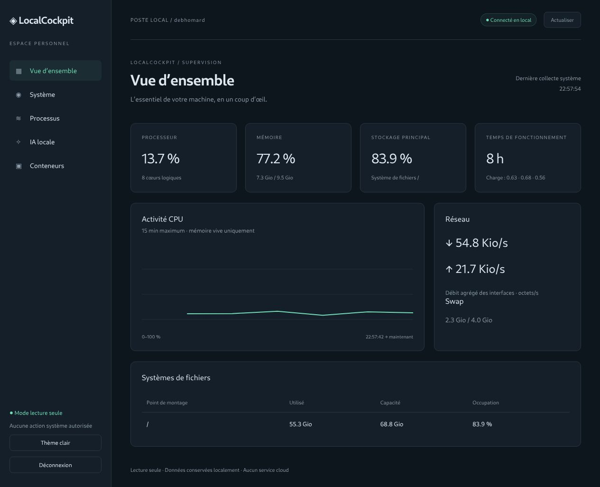
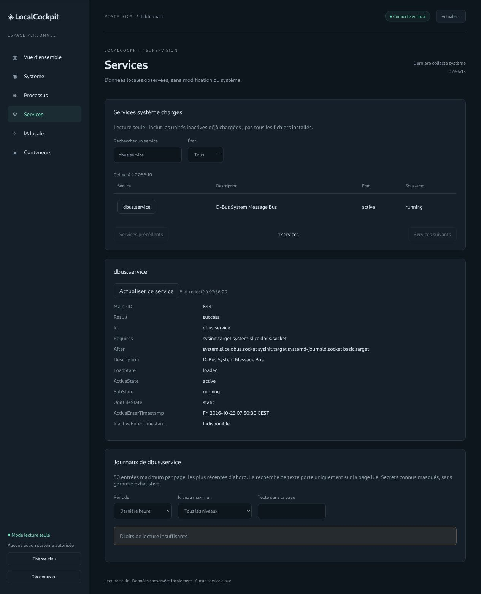
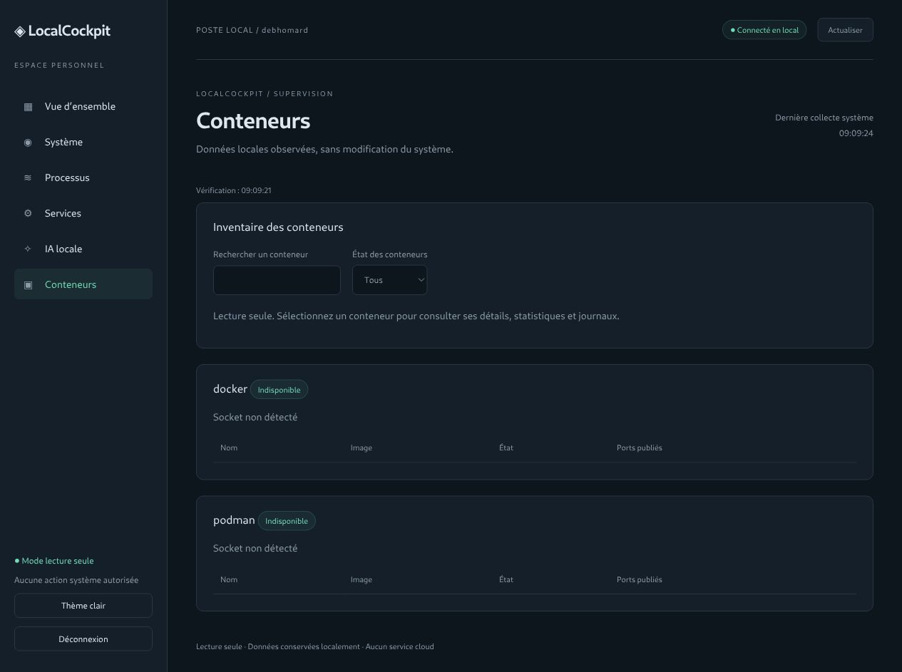
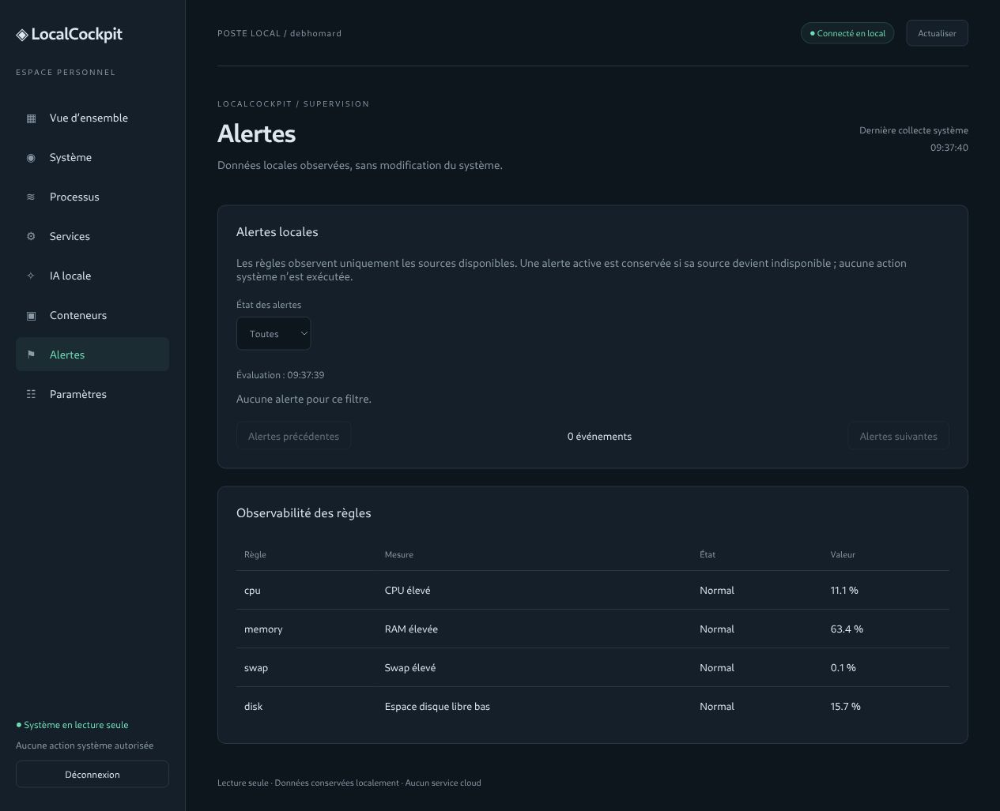
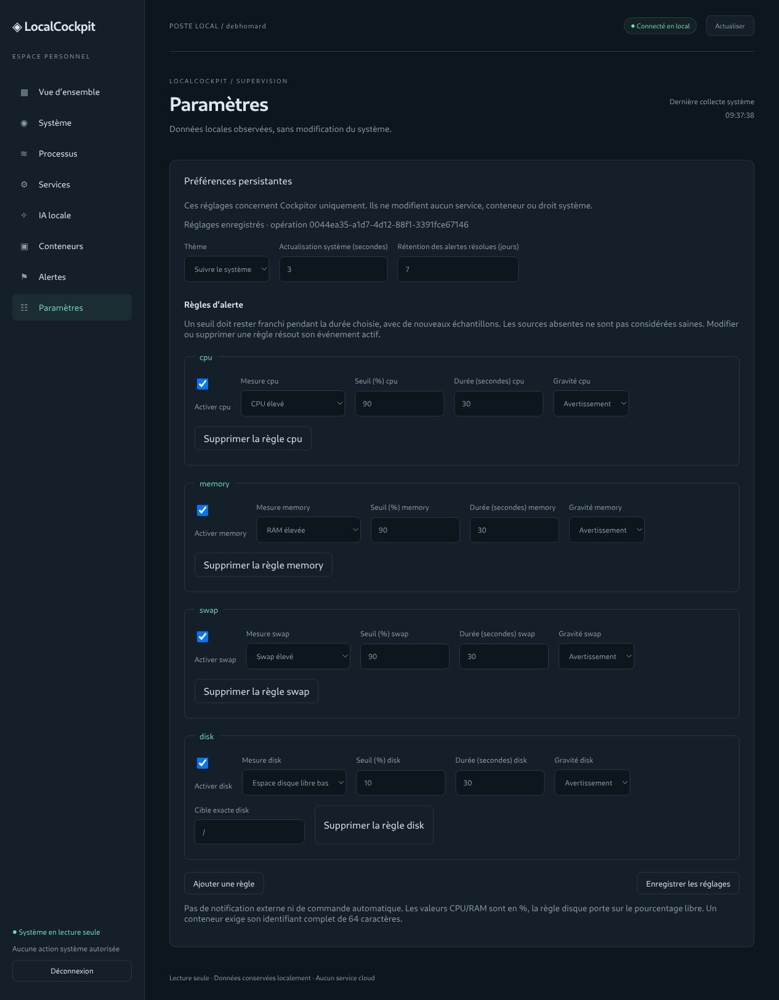
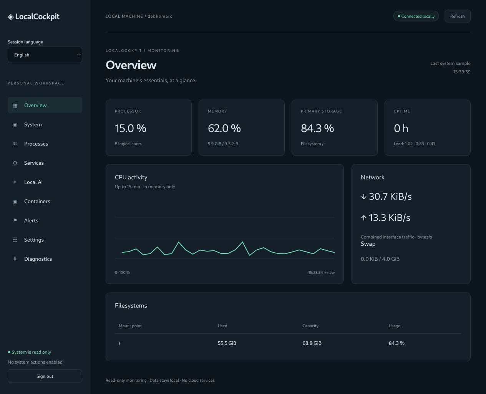
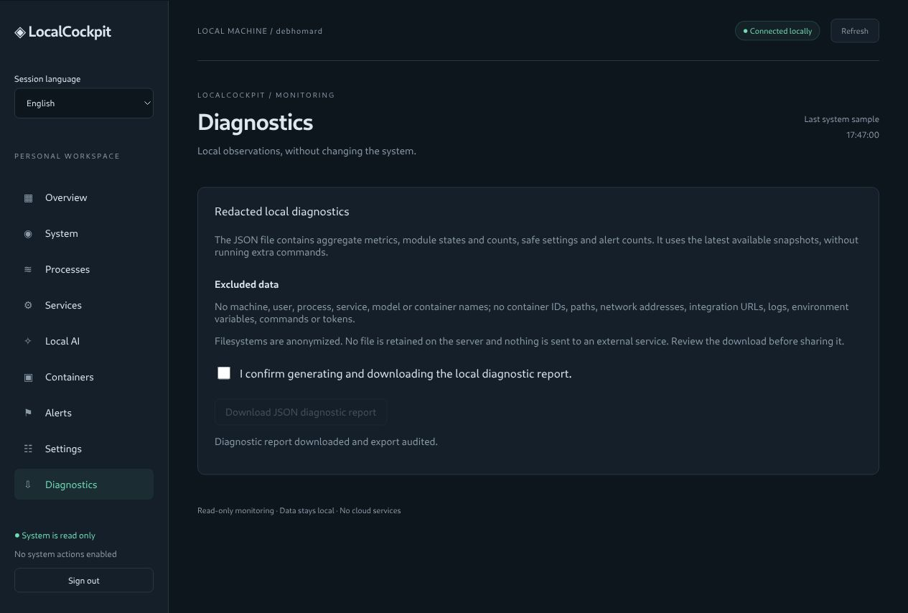
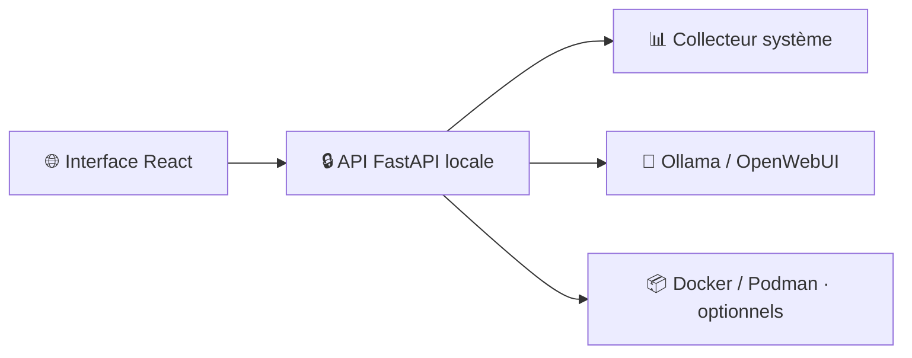

# ◈ Cockpitor

[🇬🇧 English](README.en.md) · 🇫🇷 Français

**Votre poste Linux, en un coup d’œil.**

Un cockpit personnel de supervision locale pour Debian : ressources système,
processus, IA locale et conteneurs, depuis une interface web React.
Le nom de travail affiché dans l’application est **LocalCockpit**.

**🐧 Linux / Debian** · **⚛️ React + TypeScript** · **🐍 FastAPI** · **🔒 Lecture seule** · **🏠 100 % local**

> **État : prototype 0.1.0.** Les opérations sensibles sont absentes.
> Le paquet Debian et la validation sur une installation Debian propre restent à réaliser.

[Découvrir](#-fonctionnalités) · [Installer](#-démarrage-rapide) · [Configurer](#-intégrations-optionnelles) · [Contexte](CONTEXT.md) · [Historique](CHANGELOG.md)

## 📸 Aperçu



*Capture réelle de la vue d’ensemble en thème sombre. Les valeurs dépendent de
la machine et de l’instant de collecte ; aucune donnée de démonstration n’est injectée.*

<details>
<summary>⚙️ Aperçu des services et de la gestion des permissions</summary>



</details>

## ✨ Fonctionnalités

| Module | Disponible aujourd’hui |
| --- | --- |
| 📊 **Vue d’ensemble** | CPU global, RAM, swap, uptime, charge et réseau |
| 💽 **Système** | Systèmes de fichiers, capacité et capteurs accessibles |
| ⚙️ **Services et journaux** | Services système chargés, détails, journaux paginés et erreurs de permissions explicites |
| 🔎 **Processus** | Recherche, pagination, utilisateur, CPU et mémoire |
| 📈 **Historique** | Courbe CPU, environ 15 minutes conservées en mémoire |
| 🧠 **Ollama** | Disponibilité, modèles installés et modèles chargés si exposés |
| 🌐 **OpenWebUI** | État HTTP et lien vers une URL locale configurée |
| 📦 **Docker / Podman** | Inventaire filtrable, détails, CPU/RAM et journaux bornés, avec accès explicite au socket |
| ⚑ **Alertes locales** | Règles temporisées CPU/RAM/swap/disque, Ollama, services et conteneurs ; historique actif/résolu |
| ☷ **Paramètres** | Thème clair/sombre/système, fréquence d’affichage, règles et rétention persistants dans SQLite |
| 🎨 **Interface** | Navigation responsive et préférences restaurées après redémarrage |

### 🔐 Principes

- Écoute sur `127.0.0.1`, accès par jeton local, vérification des hôtes et origines.
- Aucun arrêt de service, redémarrage de conteneur, shell ou agent privilégié.
- Aucun cloud, compte externe, CDN ou télémétrie en fonctionnement normal.
- Les intégrations absentes ne bloquent pas la surveillance système.
- Les mesures indisponibles sont signalées ; les valeurs anciennes restent horodatées.

## 🚀 Démarrage rapide

**Prérequis :** Linux, Python **3.11+**, Node.js **22.12+**, npm et Git.
Développement vérifié avec Python 3.13 et Node.js 22.23.
Les dépendances initiales nécessitent Internet ; l’application compilée fonctionne localement.

```bash
git clone https://github.com/nouhailler/cockpitor.git
cd cockpitor

python3 -m venv .venv
.venv/bin/pip install -r requirements.lock

npm ci --prefix frontend
npm run build --prefix frontend

.venv/bin/python scripts/serve.py
```

1. Ouvrir **[http://127.0.0.1:8765](http://127.0.0.1:8765)**.
2. Saisir le **jeton affiché dans le terminal** du lanceur.
3. Consulter les métriques ; les premières mesures CPU et réseau nécessitent deux collectes.

> Ne pas lancer en root. Le jeton reste en mémoire dans l’onglet et change au
> redémarrage, sauf configuration explicite. Ne jamais le placer dans une URL.
> Arrêter l’application avec `Ctrl+C`.

## 🔌 Intégrations optionnelles

### 🧠 Ollama et OpenWebUI

Ollama utilise `http://127.0.0.1:11434` par défaut.
OpenWebUI reste désactivé tant qu’aucune URL n’est configurée.

```bash
LOCALCOCKPIT_OLLAMA_URL=http://127.0.0.1:11434 \
LOCALCOCKPIT_OPENWEBUI_URL=http://127.0.0.1:3000 \
.venv/bin/python scripts/serve.py
```

Seules les **adresses IP numériques loopback** en HTTP/HTTPS sont acceptées :
pas de nom DNS, secret, chemin, fragment ou paramètres. Les redirections sont refusées.
L’état OpenWebUI indique une réponse HTTP réussie, sans accéder à sa base interne.

### 📦 Docker et Podman

L’accès aux moteurs est **désactivé par défaut**. Pour consulter un moteur,
configurer un socket auquel le compte possède déjà accès :

```bash
# Docker : activer uniquement après avoir évalué les permissions du socket.
LOCALCOCKPIT_DOCKER_SOCKET=/var/run/docker.sock \
.venv/bin/python scripts/serve.py

# Podman rootless : utiliser le socket de l’utilisateur courant.
LOCALCOCKPIT_PODMAN_SOCKET="/run/user/$(id -u)/podman/podman.sock" \
.venv/bin/python scripts/serve.py
```

> ⚠️ L’accès au socket Docker confère des pouvoirs équivalents à root,
> même si Cockpitor n’émet que des lectures. Le programme ne change aucun droit
> et n’ajoute aucun utilisateur à un groupe. Les autres emplacements, dont
> Docker rootless, doivent être configurés explicitement.

Les variables d’environnement des conteneurs ne sont pas transmises à l’interface.

Les moteurs annoncent leur version d’API de compatibilité ; Cockpitor négocie une
version comprise entre `1.24` et `1.47`. Une version incompatible est signalée.
Cliquer sur un conteneur ouvre son état, son image, ses dates, son CPU et sa mémoire
brute (cache inclus). Les informations absentes restent indiquées indisponibles.
Les journaux sont limités à 50, 100 ou 200 lignes par flux sur une heure ou 24 heures,
sans suivi continu. stdout/stderr sont regroupés séparément, sans ordre global reconstruit.
Les variables d’environnement, commandes de lancement, labels et montages restent exclus.

<details>
<summary>📦 État réel lorsque les moteurs sont absents</summary>



Les cas avec conteneurs sont testés avec des réponses contrôlées et un socket
Unix de test ; aucun moteur réel n’est installé/configuré dans l’environnement de validation.

</details>

## ⚑ Préférences et alertes

Dans **Paramètres**, enregistrer le thème, l’actualisation des métriques (3–60 s),
la rétention des alertes résolues (1–90 jours) et jusqu’à 20 règles. Les sources
sont collectées indépendamment de la fréquence d’affichage. Les valeurs initiales
surveillent CPU/RAM/swap au-dessus de 90 % et l’espace libre de `/` sous 10 %, pendant 30 s.
Les règles sur services et conteneurs demandent une cible exacte déjà observable.

Dans **Alertes**, consulter les événements actifs/résolus et l’observabilité des
règles. Une source absente/périmée n’est jamais assimilée à un état sain ; elle ne
résout pas une alerte active. Les durées en attente repartent après redémarrage,
mais les événements actifs/résolus persistent. Aucune notification externe ni
commande automatique n’est déclenchée.

La base est privée : `.localcockpit/cockpitor.sqlite3` dans le projet, dossier
`0700`, fichier `0600`, exclus de Git. `LOCALCOCKPIT_DATA_DIR` permet de choisir
un autre dossier dédié au lancement. Ne pas choisir un répertoire partagé.
Conserver/sauvegarder ce dossier avant de supprimer le checkout. Aucun jeton ou
mot de passe n’est stocké dans la base. Une panne SQLite laisse la supervision disponible.

> Les écritures API autorisées sont **PUT /api/v1/settings**, pour les réglages,
> et **POST /api/v1/diagnostics**, pour un export confirmé. Les protections
> de l’application : jeton d’accès, origine locale exacte, en-tête CSRF et JSON
> borné sont requises. Les mutations système restent interdites.


<details>
<summary>⚑ Captures réelles des alertes et des réglages</summary>





</details>

## 🌍 Français / English et diagnostic

Le sélecteur **Langue de la session** change immédiatement l’interface. Dans
**Paramètres → Langue**, enregistrer la langue pour les prochaines connexions.
La préférence persistante est appliquée après authentification ; les anciennes
bases adoptent le français. Dates, nombres et unités suivent la langue choisie.
Les noms externes et les journaux conservent leur texte d’origine.

Dans **Diagnostic**, confirmer puis télécharger un JSON limité à 64 Kio : métriques
agrégées, états des modules, réglages non sensibles et compteurs d’alertes.
Une liste blanche exclut noms, identifiants, chemins, adresses, journaux,
environnement et jetons. Aucun fichier n’est conservé sur le serveur ni envoyé
à un tiers. Vérifier le fichier avant partage : les agrégats décrivent encore la machine.
L’export reste disponible si SQLite tombe en panne, avec audit signalé indisponible.



<details>
<summary>⇩ Diagnostic confirmé et audité</summary>



</details>

## 🏗️ Architecture



```text
cockpitor/
├── backend/app/        # API, sécurité HTTP, collecte et intégrations
├── backend/tests/      # Tests système, API et adaptateurs
├── frontend/src/       # Interface React / TypeScript et styles
├── frontend/tests/     # Tests d’interface
├── scripts/serve.py    # Lanceur utilisateur, loopback uniquement
├── docs/               # Cahier des charges, guides et conformité
└── .github/workflows/  # Vérifications CI
```

## 🧪 Vérifications

```bash
.venv/bin/ruff check backend scripts
.venv/bin/ruff format --check backend scripts
.venv/bin/mypy backend/app
.venv/bin/pytest -q

npm run lint --prefix frontend
npm run format:check --prefix frontend
npm test --prefix frontend
npm run build --prefix frontend
npm audit --prefix frontend
```

Validation locale de cette version : **109 tests backend et 18 tests frontend
réussis**, contrôles de types et build passants. La CI exécute ces vérifications ;
son état courant est consultable dans [GitHub Actions](https://github.com/nouhailler/cockpitor/actions).
Les tests d’intégration utilisent des services simulés, sans clé externe.

## 🗺️ Prochaines étapes

- [x] Surveillance système et interface locale.
- [x] Surveillance Ollama et état HTTP OpenWebUI.
- [x] Inventaire optionnel Docker/Podman en lecture seule.
- [x] Détails, statistiques et journaux bornés des conteneurs (qualification sur moteurs réels à réaliser).
- [x] Services systemd chargés et lecture bornée des journaux par service.
- [ ] Sessions avec expiration et limitation des tentatives.
- [x] Préférences SQLite et alertes locales.
- [x] Diagnostic expurgé et interface français/anglais.
- [ ] Paquet `.deb`, durcissement systemd et validation Debian.
- [ ] Actions sensibles, **uniquement après validation des protections et tests dédiés**.

## 📚 Documentation

| Document | Contenu |
| --- | --- |
| [CONTEXT](CONTEXT.md) | État du projet, décisions et règles de reprise |
| [CHANGELOG](CHANGELOG.md) | Historique des changements |
| [Cahier des charges](docs/cahier_des_charges_localcockpit_debian.md) | Exigences de référence |
| [Plan d’implémentation](docs/IMPLEMENTATION_PLAN.md) | Lots et avancement |
| [Conformité](docs/CONFORMITY.md) | Fonctions, preuves et limites connues |
| [Architecture](docs/ARCHITECTURE.md) | Composants et flux |
| [Sécurité](docs/SECURITY.md) | Protections et frontières de confiance |
| [Installation](docs/INSTALL.md) | Configuration, arrêt et désinstallation |
| [API](docs/API.md) | Routes, unités et erreurs |
| [Tests](docs/TESTING.md) | Vérifications et environnements |
| [Guide utilisateur](docs/USER_GUIDE.md) | Interprétation des données |
