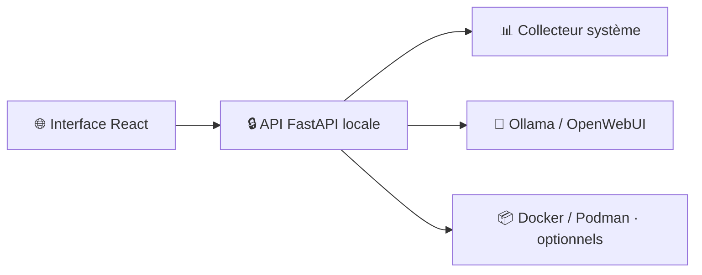

# ◈ Cockpitor

**Votre poste Linux, en un coup d’œil.**

Un cockpit personnel de supervision locale pour Debian : ressources système,
processus, IA locale et conteneurs, depuis une interface web React.
Le nom de travail affiché dans l’application est **LocalCockpit**.

**🐧 Linux / Debian** · **⚛️ React + TypeScript** · **🐍 FastAPI** · **🔒 Lecture seule** · **🏠 100 % local**

> **État : prototype 0.1.0.** Les opérations sensibles sont absentes.
> Le paquet Debian et la validation sur une installation Debian propre restent à réaliser.

[Découvrir](#-fonctionnalités) · [Installer](#-démarrage-rapide) · [Configurer](#-intégrations-optionnelles) · [Contexte](CONTEXT.md) · [Historique](CHANGELOG.md)

## 📸 Aperçu


*Capture réelle de la vue d’ensemble en thème sombre. Les valeurs dépendent de
la machine et de l’instant de collecte ; aucune donnée de démonstration n’est injectée.*

## ✨ Fonctionnalités

| Module | Disponible aujourd’hui |
| --- | --- |
| 📊 **Vue d’ensemble** | CPU global, RAM, swap, uptime, charge et réseau |
| 💽 **Système** | Systèmes de fichiers, capacité et capteurs accessibles |
| 🔎 **Processus** | Recherche, pagination, utilisateur, CPU et mémoire |
| 📈 **Historique** | Courbe CPU, environ 15 minutes conservées en mémoire |
| 🧠 **Ollama** | Disponibilité, modèles installés et modèles chargés si exposés |
| 🌐 **OpenWebUI** | État HTTP et lien vers une URL locale configurée |
| 📦 **Docker / Podman** | Inventaire, état, image et ports publiés, avec accès explicite au socket |
| 🎨 **Interface** | Navigation responsive et thèmes clair/sombre |

### 🔐 Principes

- Écoute sur `127.0.0.1`, accès par jeton local, vérification des hôtes et origines.
- Aucun arrêt de service, redémarrage de conteneur, shell ou agent privilégié.
- Aucun cloud, compte externe, CDN ou télémétrie en fonctionnement normal.
- Les intégrations absentes ne bloquent pas la surveillance système.
- Les mesures indisponibles sont signalées ; les valeurs anciennes restent horodatées.

## 🚀 Démarrage rapide

**Prérequis :** Linux, Python **3.11+**, Node.js **22.12+**, npm et Git.
Développement vérifié avec Python 3.13 et Node.js 22.23.
Les dépendances initiales nécessitent Internet ; l’application compilée fonctionne localement.

```bash
git clone https://github.com/nouhailler/cockpitor.git
cd cockpitor

python3 -m venv .venv
.venv/bin/pip install -r requirements.lock

npm ci --prefix frontend
npm run build --prefix frontend

.venv/bin/python scripts/serve.py
```

1. Ouvrir **[http://127.0.0.1:8765](http://127.0.0.1:8765)**.
2. Saisir le **jeton affiché dans le terminal** du lanceur.
3. Consulter les métriques ; les premières mesures CPU et réseau nécessitent deux collectes.

> Ne pas lancer en root. Le jeton reste en mémoire dans l’onglet et change au
> redémarrage, sauf configuration explicite. Ne jamais le placer dans une URL.
> Arrêter l’application avec `Ctrl+C`.

## 🔌 Intégrations optionnelles

### 🧠 Ollama et OpenWebUI

Ollama utilise `http://127.0.0.1:11434` par défaut.
OpenWebUI reste désactivé tant qu’aucune URL n’est configurée.

```bash
LOCALCOCKPIT_OLLAMA_URL=http://127.0.0.1:11434 \
LOCALCOCKPIT_OPENWEBUI_URL=http://127.0.0.1:3000 \
.venv/bin/python scripts/serve.py
```

Seules les **adresses IP numériques loopback** en HTTP/HTTPS sont acceptées :
pas de nom DNS, secret, chemin, fragment ou paramètres. Les redirections sont refusées.
L’état OpenWebUI indique une réponse HTTP réussie, sans accéder à sa base interne.

### 📦 Docker et Podman

L’accès aux moteurs est **désactivé par défaut**. Pour consulter un moteur,
configurer un socket auquel le compte possède déjà accès :

```bash
# Docker : activer uniquement après avoir évalué les permissions du socket.
LOCALCOCKPIT_DOCKER_SOCKET=/var/run/docker.sock \
.venv/bin/python scripts/serve.py

# Podman rootless : utiliser le socket de l’utilisateur courant.
LOCALCOCKPIT_PODMAN_SOCKET="/run/user/$(id -u)/podman/podman.sock" \
.venv/bin/python scripts/serve.py
```

> ⚠️ L’accès au socket Docker confère des pouvoirs équivalents à root,
> même si Cockpitor n’émet que des lectures. Le programme ne change aucun droit
> et n’ajoute aucun utilisateur à un groupe. Les autres emplacements, dont
> Docker rootless, doivent être configurés explicitement.

Les variables d’environnement des conteneurs ne sont pas transmises à l’interface.

## 🏗️ Architecture



```text
cockpitor/
├── backend/app/        # API, sécurité HTTP, collecte et intégrations
├── backend/tests/      # Tests système, API et adaptateurs
├── frontend/src/       # Interface React / TypeScript et styles
├── frontend/tests/     # Tests d’interface
├── scripts/serve.py    # Lanceur utilisateur, loopback uniquement
├── docs/               # Cahier des charges, guides et conformité
└── .github/workflows/  # Vérifications CI
```

## 🧪 Vérifications

```bash
.venv/bin/ruff check backend scripts
.venv/bin/ruff format --check backend scripts
.venv/bin/mypy backend/app
.venv/bin/pytest -q

npm run lint --prefix frontend
npm run format:check --prefix frontend
npm test --prefix frontend
npm run build --prefix frontend
npm audit --prefix frontend
```

Validation locale de cette version : **19 tests backend et 4 tests frontend
réussis**, contrôles de types et build passants. La CI exécute ces vérifications ;
son état courant est consultable dans [GitHub Actions](https://github.com/nouhailler/cockpitor/actions).
Les tests d’intégration utilisent des services simulés, sans clé externe.

## 🗺️ Prochaines étapes

- [x] Surveillance système et interface locale.
- [x] Surveillance Ollama et état HTTP OpenWebUI.
- [x] Inventaire optionnel Docker/Podman en lecture seule.
- [ ] Détails, statistiques et journaux des conteneurs.
- [ ] Services systemd et lecture bornée des journaux.
- [ ] Sessions avec expiration et limitation des tentatives.
- [ ] Préférences persistantes, alertes et diagnostic expurgé.
- [ ] Paquet `.deb`, durcissement systemd et validation Debian.
- [ ] Actions sensibles, **uniquement après validation des protections et tests dédiés**.

## 📚 Documentation

| Document | Contenu |
| --- | --- |
| [CONTEXT](CONTEXT.md) | État du projet, décisions et règles de reprise |
| [CHANGELOG](CHANGELOG.md) | Historique des changements |
| [Cahier des charges](docs/cahier_des_charges_localcockpit_debian.md) | Exigences de référence |
| [Plan d’implémentation](docs/IMPLEMENTATION_PLAN.md) | Lots et avancement |
| [Conformité](docs/CONFORMITY.md) | Fonctions, preuves et limites connues |
| [Architecture](docs/ARCHITECTURE.md) | Composants et flux |
| [Sécurité](docs/SECURITY.md) | Protections et frontières de confiance |
| [Installation](docs/INSTALL.md) | Configuration, arrêt et désinstallation |
| [API](docs/API.md) | Routes, unités et erreurs |
| [Tests](docs/TESTING.md) | Vérifications et environnements |
| [Guide utilisateur](docs/USER_GUIDE.md) | Interprétation des données |
